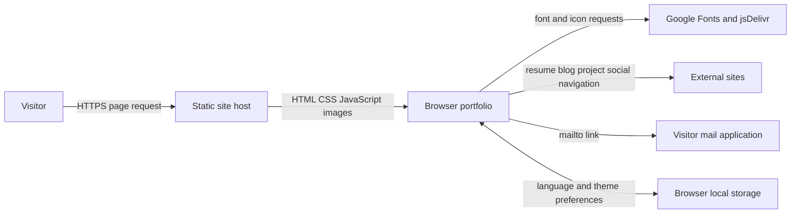
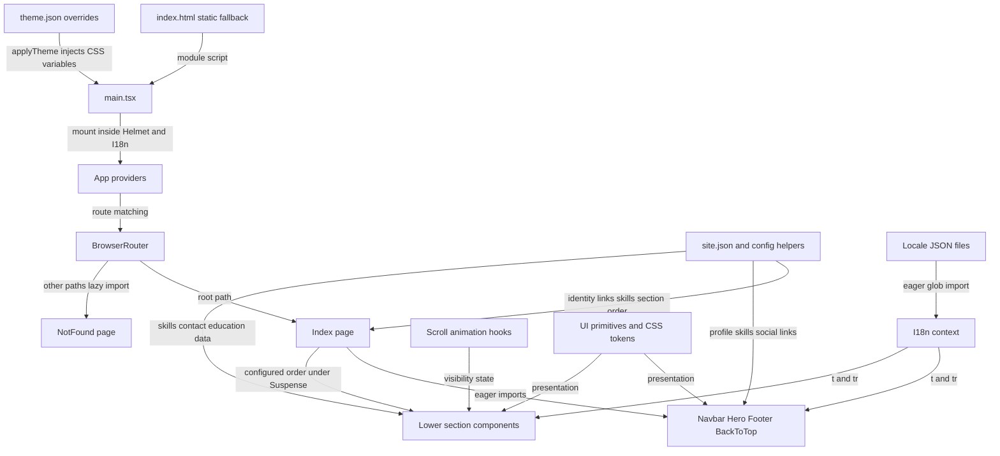
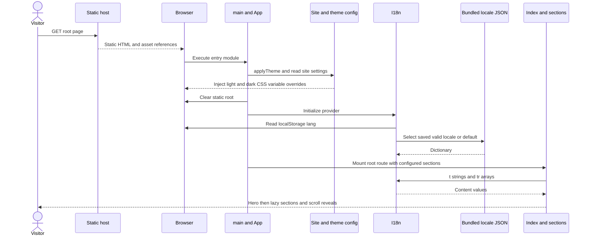
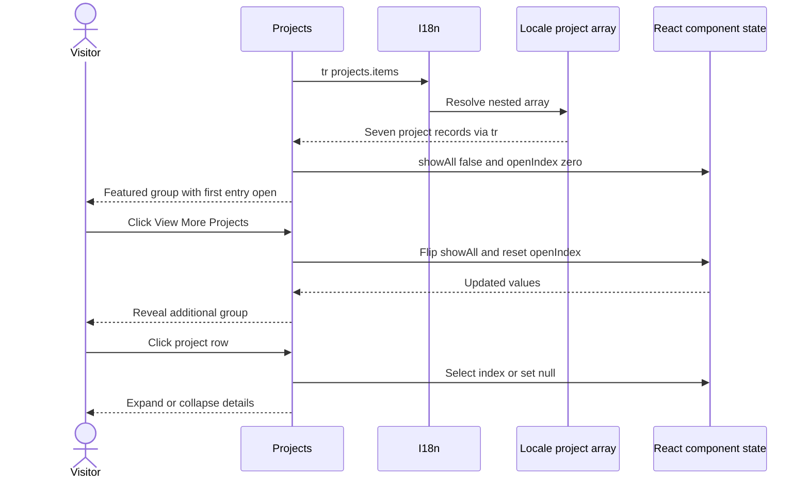
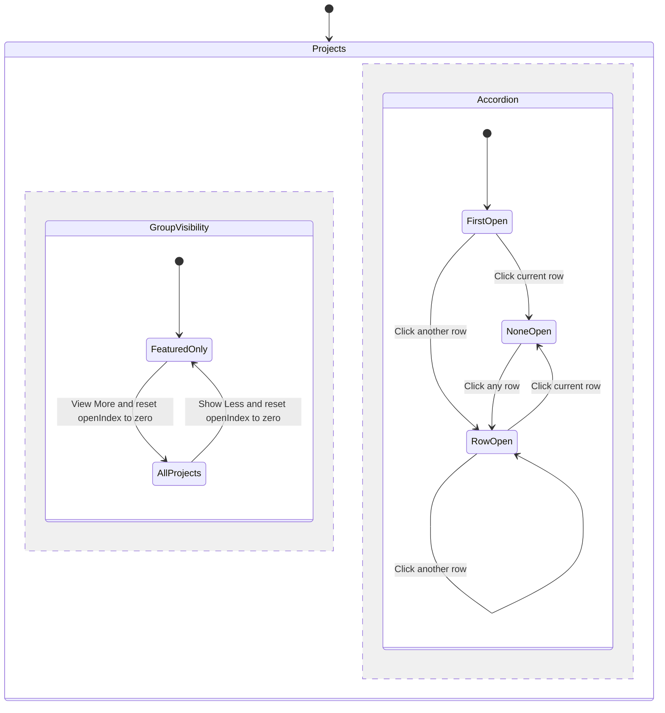
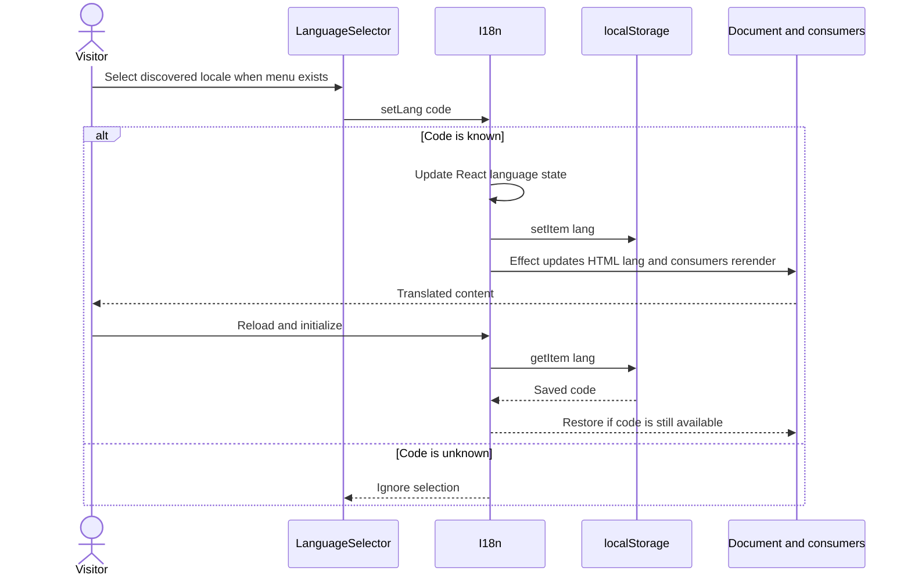
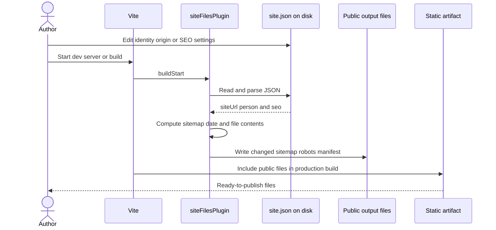

# Architecture and traced flows

Purpose: explain runtime boundaries and data movement. Intended reader: developers and architecture reviewers.

Last verified against commit `e7f95698811156a1fa4a1807fdd6cc2c6e5a5e76` on 2026-10-18.

## System context

**[Verified]** A browser runs a static portfolio application. Fonts/icons are fetched as resources, while resume, blog, project, and social URLs are ordinary navigation links. No application API client or server is implemented. Evidence: [Hero](../src/components/sections/Hero.tsx), [Blog](../src/components/sections/Blog.tsx), [Contact](../src/components/sections/Contact.tsx), [Footer](../src/components/Footer.tsx).

Caption: the portfolio serves content and hands off outbound actions. How to read: resource-fetch edges differ from links that leave the application; the host's actual configuration is **[Unknown]**.

## Containers and component boundaries

**[Verified]** Vite bundles the browser app; it is not a production backend. [main.tsx:8](../src/main.tsx#L8) calls `applyTheme()`, then clears `#root` at line 12 and calls `createRoot`. Static HTML is replaced rather than hydrated, despite the source comment. Config imports supply identity/URLs, theme defaults, section order, media paths, and skill data. [Config](../src/config/index.ts), [HTML](../index.html), [App](../src/App.tsx).

Caption: provider, routing, content, and presentation responsibilities are separate files. How to read: arrows label runtime composition/data dependencies; `App` also wraps theme, query, tooltip, and two lazy toast providers.

**[Verified]** Section components depend on i18n, UI primitives, scroll hooks, and (where needed) config. Config imports JSON without importing components; Footer resolves platform IDs through [BrandIcons](../src/components/icons/BrandIcons.tsx). Hero and Skills share `siteConfig.skills` via `allSkills()`/`resolveIcon()`. i18n remains independent of section components. No circular import was found in the inspected runtime path; this was not a formal whole-repository cycle analysis. [Config](../src/config/index.ts), [i18n](../src/i18n/i18n.tsx), [utils](../src/lib/utils.ts).

## Flow 1: initial visit to rendered content

**[Verified]** The HTML contains metadata, JSON-LD, and portfolio markup. Startup injects theme overrides, clears the static root, restores a valid language or chooses English, mounts the root route, and renders known lower sections in config order under one null Suspense boundary. Unknown section IDs are skipped by Index but still become navbar links. Hero/Footer remain outside this section list. Evidence: [main:8](../src/main.tsx#L8), [i18n:50](../src/i18n/i18n.tsx#L50), [Index:19](../src/pages/Index.tsx#L19), [Navbar:10](../src/components/Navbar.tsx#L10).

Caption: config and locale content are bundled; local media is served by public paths. How to read: storage restores only preferences; section chunks load asynchronously, and failures have no custom error boundary.

## Flow 2: reveal projects and inspect an entry

**[Verified]** `Projects.tsx:20` reads `projects.items`; lines 24–25 partition by `featured`. Initial state is `showAll=false`, `openIndex=0`. A row click selects that index or closes it. Show More/Less toggles the additional group and resets the open index to zero (`Projects.tsx:189`). External link clicks stop propagation and open a new tab. No write reaches persistent storage.

Caption: this journey reads bundled records and writes only ephemeral UI state. How to read: a reload/remount resets state; source is [Projects](../src/components/sections/Projects.tsx).

Caption: group visibility and accordion selection are concurrent state dimensions. How to read: the two regions summarize `showAll` and `openIndex`; visibility-toggle actions also reset the accordion to its first row. Neither dimension persists across remounts.

## Flow 3: choose and restore a language

**[Verified]** This path becomes user-accessible when a second locale file is added. Currently [en.json](../src/locales/en.json) is the only locale, and [LanguageSelector:16](../src/components/LanguageSelector.tsx#L16) renders a label instead of a menu. `setLang` rejects unknown codes, writes the `lang` preference, and triggers an HTML `lang` update. A valid locale missing an individual key does not fall back to English ([i18n:58](../src/i18n/i18n.tsx#L58)).

Caption: language is the app-owned persistent preference flow. How to read: storage access has no try/catch; unavailable/denied storage is an unresolved failure case, not a handled branch.

## State, async behavior, reliability, and security

**[Verified]** UI state is local React state; language uses context/localStorage. Theme behavior is delegated to next-themes with `siteConfig.theme.default`; `applyTheme()` adds authored token overrides. The query client has no portfolio `useQuery`/`useMutation` consumers. There are no queues, database transactions, or N+1 queries. Lazy imports, observers, animations, and toast timers are the relevant asynchronous mechanisms ([App](../src/App.tsx), [config](../src/config/index.ts), [scroll hook](../src/hooks/useScrollAnimation.ts), [toast hook](../src/hooks/use-toast.ts)).

**[Inferred]** Static assets can be distributed through a cache/CDN without per-user server computation because all content is bundled. Main reliability concerns are failed JavaScript/chunk loads, missing third-party resources, and content drift across JSON/HTML. All locales are eagerly bundled, so adding large dictionaries increases client payload. No explicit asset caching policy, service worker, runtime error reporting, or custom React error boundary is checked in.

**[Verified]** The portfolio is public. There is no authentication, authorization, contact-input submission, or server-secret requirement. `RichText` renders React nodes. Config and locale URLs/CSS token values are trusted authored input without general URL/CSS/schema validation. Config's four required-field checks only log to the browser console; they do not throw or stop startup, despite the "Fail fast" comment. See [config:31](../src/config/index.ts#L31), [RichText](../src/components/RichText.tsx), [Contact](../src/components/sections/Contact.tsx). Host TLS/security headers remain **[Unknown]**.

## Flow 4: config to generated public files

**[Verified]** [Vite](../vite.config.ts) registers `siteFilesPlugin()` in every mode. Its `buildStart` hook reads site JSON from the current working directory and writes changed sitemap, robots, and manifest content into `public/`. The sitemap uses the current UTC day, not a source-content modification timestamp. The plugin has no custom config-file watch hook or error recovery; run a new dev/build cycle to regenerate after config changes. It does not generate `index.html`, JSON-LD, or `llms.txt` ([site-files.ts:10](../scripts/site-files.ts#L10)).

Caption: the generator runs in Node during dev/build, separately from browser rendering. How to read: malformed JSON/filesystem errors fail this path; there is no backend write by a visitor, and preview does not perform a new build.

## Decisions and trade-offs

| Observation | Likely rationale and consequence |
| --- | --- |
| [Verified] Static JSON instead of CMS | [Inferred] Simple publishing and no service credentials; editing content requires rebuilding |
| [Verified] Site/theme config separated from locales | [Inferred] Easier reuse of identity/media/style settings; record arrays, prose facts, static HTML and llms content still need coordinated editing |
| [Verified] Three files generated by a Vite plugin | [Inferred] Reduces drift for crawler/manifest fields; writes tracked outputs and uses build date, while the larger SEO surfaces remain manual |
| [Verified] Custom i18n context and eager glob | [Inferred] Adding files is simple; schema validation and per-key fallback must be supplied separately |
| [Verified] Static root plus React replacement | [Inferred] Provides initial machine-readable content; duplicates maintenance and is not SSR hydration |
| [Verified] Lazy lower sections with null fallback | [Inferred] Reduces initial module work; offers no loading feedback and can delay navigation targets |
| [Verified] Broad UI kit, Query provider, two toaster systems | [Unknown] Intended future consumers; assess usage before removing |

Evidence: [i18n](../src/i18n/i18n.tsx), [config](../src/config/index.ts), [generator](../scripts/site-files.ts), [Index](../src/pages/Index.tsx). **[Verified]** No ADR directory was found. [AGENTS.md](../AGENTS.md) records architecture rules and the [template plan](../.lovable/plan/make-the-portfolio-a-fully-configurable-template-2026-10-02.md) records goals; neither establishes that every planned feature shipped. The [original portfolio plan](_archive/original-portfolio-plan.md) remains historical intent.

Next: [Code guide](04-code-guide.md).
