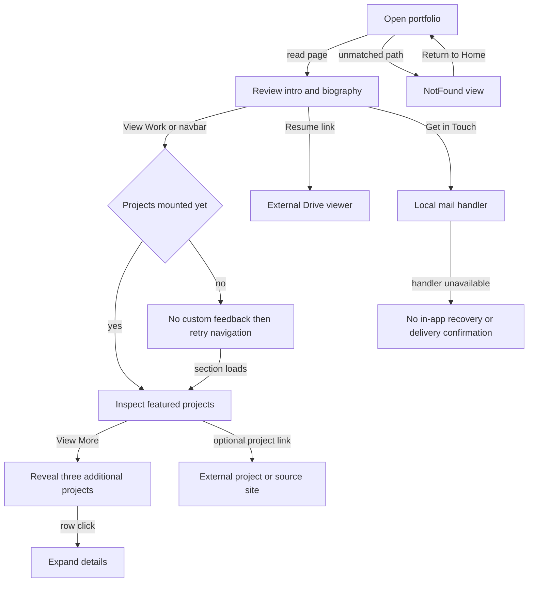

# Product guide

Purpose: separate delivered user behavior from design intent. Intended reader: product owners, content editors, and frontend reviewers.

Last verified against commit `0d6ea67e368badc5e2d52b7c601ea167c6be6208` on 2026-10-17.

## Audiences and feature inventory

**[Inferred]** Recruiters review experience/resume, collaborators review projects/contact, and technical readers follow article/source links. **[Verified]** Every visitor has the same public read access; there are no accounts, permission tiers, authoring screens, or admin routes in [App](../src/App.tsx).

**[Verified]** Status below means implementation exists in source, not that browser accessibility or production availability has been certified.

| Feature | User | Entry point | Status | Evidence |
| --- | --- | --- | --- | --- |
| Intro/photo/resume | All visitors | `/`, hero | Implemented; resume is a Drive viewer link | [Hero](../src/components/sections/Hero.tsx) |
| About/stats | All visitors | `/#about` | Implemented; stats are literal strings, not counters | [About](../src/components/sections/About.tsx) |
| Employment | All visitors | `/#experience` | Implemented single-open accordion; two records | [Experience](../src/components/sections/Experience.tsx), [content](../src/locales/en.json) |
| Education | All visitors | `/#education` | Implemented accordion; two records | [Education](../src/components/sections/Education.tsx) |
| Projects | All visitors | `/#projects` | Implemented; seven records, four featured, three additional | [Projects](../src/components/sections/Projects.tsx), [content](../src/locales/en.json) |
| Skills | All visitors | `/#skills` | Implemented; 24 entries across five groups | [Skills](../src/components/sections/Skills.tsx) |
| Article previews | All visitors | `/#blog` | Implemented static list of three; no feed synchronization | [Blog](../src/components/sections/Blog.tsx) |
| Contact | All visitors | `/#contact` | Implemented mailto and LinkedIn links | [Contact](../src/components/sections/Contact.tsx) |
| Contact form | All visitors | Original design plan only | Planned, not implemented | [plan](../.lovable/plan.md), [Contact](../src/components/sections/Contact.tsx) |
| Theme | All visitors | Navbar | Implemented system default and dark/light toggle | [App](../src/App.tsx), [toggle](../src/components/ThemeToggle.tsx) |
| Language | All visitors | Navbar | Partial: multi-locale machinery, English content only | [selector](../src/components/LanguageSelector.tsx), [locale](../src/locales/en.json) |
| Navigation/mobile menu | All visitors | Fixed header | Implemented scroll/menu; active observation timing risk | [Navbar](../src/components/Navbar.tsx) |
| Error page | All visitors | Unmatched pathname | Implemented noindex view and home link; host status unknown | [NotFound](../src/pages/NotFound.tsx) |
| Social/footer/back-to-top | All visitors | Bottom of page / after scroll | Implemented; eight social links | [Footer](../src/components/Footer.tsx), [BackToTop](../src/components/BackToTop.tsx) |

## Key journeys and edge paths

Caption: the site supports discovery and outbound handoffs. How to read: mounting and mail-handler branches are limitations inferred from source handlers, not observed production incidents. The three detailed sequence diagrams are in [architecture](03-architecture.md).

**[Verified]** Project and resume links do not cause a submission or track a conversion in application code. Blog articles open externally; they have no route in this app. Contact does not validate fields, send email, or confirm delivery because there are no contact fields or submission handler. Sources: [Hero](../src/components/sections/Hero.tsx), [Projects](../src/components/sections/Projects.tsx), [Blog](../src/components/sections/Blog.tsx), [Contact](../src/components/sections/Contact.tsx).

## Usability and accessibility observations

**[Verified]** Positive source-level features include a skip link, semantic main/section/article elements, many named navigation controls, image dimensions, external-link safety attributes, and a reduced-motion rule for the marquee. Sources: [Index](../src/pages/Index.tsx), [Hero](../src/components/sections/Hero.tsx), [index.css:124](../src/index.css#L124).

**[Verified]** Project rows place anchors inside buttons (`Projects.tsx:66–82`, repeated at 132 onward). Accordion buttons omit `aria-expanded`/`aria-controls`. Collapsed panels use opacity and max-height rather than removal/`hidden`; additional project anchors remain in the DOM. The mobile menu has no explicit focus trap, Escape handling, focus restoration, or `aria-expanded` state on its custom toggle. BackToTop uses opacity/pointer-events while retaining its button. Evidence: [Projects](../src/components/sections/Projects.tsx), [Experience](../src/components/sections/Experience.tsx), [Education](../src/components/sections/Education.tsx), [Navbar](../src/components/Navbar.tsx), [BackToTop](../src/components/BackToTop.tsx).

**[Inferred]** These patterns can cause keyboard/assistive-technology confusion and hidden focus targets. Fixed accordion heights may clip longer translations. Hero View Work and navbar silently do nothing when their target is absent; lower sections have no loading feedback. The theme toggle compares the literal `theme` value, so a system-dark session can choose dark again on its first click instead of visibly changing. Global reduced-motion support is incomplete: the inspected rule disables the marquee, while smooth-scroll calls and reveal transitions remain. Browser, keyboard, screen-reader, and contrast testing remain **[Unknown]**; these are review targets, not a conformance verdict.

## Content intent and measurement

**[Verified]** SEO is spread across static metadata/JSON-LD/fallback HTML, React Helmet, microdata, hidden `data-geo-summary` text, and `llms.txt`. Seven project records exist but the project summary and JSON-LD still describe six. No checked-in analytics client, experiment assignment, runtime feature flag system, or A/B event hooks were found. `featured` is a content grouping field, not a rollout flag. Sources: [HTML](../index.html), [Index](../src/pages/Index.tsx), [content](../src/locales/en.json), [llms.txt](../public/llms.txt).

Questions for the product/content owner: should contact remain a mail handoff or become a real form; which languages are intended; which project list should crawlers see; should "25+ technologies" reflect the 24 rendered entries; and is a resume viewer sufficient for a download-labeled fallback link? These are **[Unknown]** decisions, not implied implementation requirements.

Next: [Data model](06-data-model.md).
