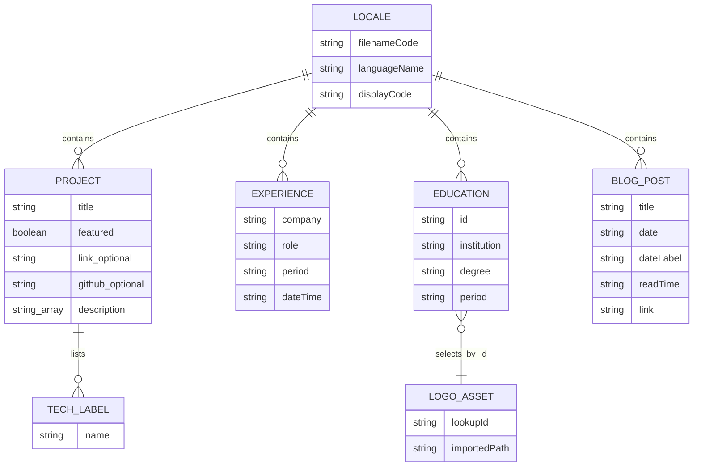

# Data model and lifecycle

Purpose: describe authored records and browser state. Intended reader: content editors and developers.

Last verified against commit `0d6ea67e368badc5e2d52b7c601ea167c6be6208` on 2026-10-17.

## Storage model

**[Verified]** There is no database schema, ORM, migration framework, or application-server persistence in this checkout. Content is source-controlled JSON plus TSX constants and static HTML. Locale files are eagerly imported into the JavaScript bundle by [i18n:6](../src/i18n/i18n.tsx#L6). Runtime visitors do not edit these records.

**[Verified]** [en.json](../src/locales/en.json) has top-level `language`, `nav`, `hero`, `about`, `experience`, `education`, `projects`, `skills`, `blog`, `contact`, `footer`, and `common` objects. Nested field names are the lookup API; changing them requires corresponding consumer changes.

| Logical record | Fields / constraints in current code | Consumer |
| --- | --- | --- |
| Language metadata | `name`, `code` display label; actual language ID comes from filename | [i18n](../src/i18n/i18n.tsx) |
| About paragraphs/stat | `paragraphs: string[]`; stats `{value, label}[]`; values remain strings | [About](../src/components/sections/About.tsx) |
| Experience item | `company`, `role`, `period`, `dateTime`, `description: string[]` | [Experience](../src/components/sections/Experience.tsx) |
| Education item | `id`, `institution`, `degree`, `period`, `details: string[]`; ID maps to local logo | [Education](../src/components/sections/Education.tsx) |
| Project item | `title`, optional `link`, `github`, `isExternal`; `description: string[]`, `tech: string[]`, `featured: boolean` | [Projects](../src/components/sections/Projects.tsx) |
| Blog post | `title`, `excerpt`, `date`, `dateLabel`, `readTime`, `link`; date label is authored separately | [Blog](../src/components/sections/Blog.tsx) |
| Contact | `email`, `linkedinUrl`, button/heading text, `geoSummary` | [Contact](../src/components/sections/Contact.tsx) |
| Skill category | Static `id` and `skills[{name,icon}]`; locale holds category labels | [Skills](../src/components/sections/Skills.tsx) |
| Social link | Static `href`, icon component, ID, hover color; locale holds labels | [Footer](../src/components/Footer.tsx) |

**[Verified]** Interfaces are local TypeScript interfaces, not JSON validators. A cast through `tr<T>()` does not enforce field presence or element types. Some missing arrays default to empty, but a non-array value can still break `.map`/`.filter`. `isExternal` is currently unused by the project renderer. No uniqueness/index constraints are enforced; titles and company/role combinations serve as React keys.

## Conceptual entity relationships

Caption: these are conceptual JSON containment and code-lookup relationships, not SQL tables or foreign keys. How to read: arrays create many contained records; the education logo lookup must be maintained manually. Evidence: [locale](../src/locales/en.json), [Education:8](../src/components/sections/Education.tsx#L8).

## Runtime state and persistence

| State | Location / lifetime | Behavior |
| --- | --- | --- |
| Selected language | React context and localStorage `lang` | Restore only codes present in bundled translations; otherwise default English |
| Theme | next-themes provider | System default; persistence implementation delegated to dependency |
| Project visibility/open row | Projects component state | `false`/`0` initial values; reset on remount |
| Experience/education open row | Each section's state | Initially index zero; current click can set null |
| Menu, active section, scrolled header | Navbar state | Browser session/component lifetime only |
| Revealed sections | Scroll-hook state | First intersection sets visible and stops observing that element |
| Toasts | Module memory and timers | Not durable; hook limits visible store to one toast |

**[Verified]** Sources: [i18n:50](../src/i18n/i18n.tsx#L50), [App](../src/App.tsx), [Projects](../src/components/sections/Projects.tsx), [Navbar](../src/components/Navbar.tsx), [scroll hook](../src/hooks/useScrollAnimation.ts), [toast hook](../src/hooks/use-toast.ts). Theme storage key/synchronization is delegated rather than configured in local source. The checked-in app adds no language `storage` listener; cross-tab language synchronization is not implemented.

## Lifecycle and edits

**[Verified]** Authored content follows commit → dependency install/build → static artifact → browser bundle. Changes require a rebuild/deploy. There are no data migration commands, retention jobs, user uploads, or record deletion endpoints. Browser language preference remains until overwritten/cleared by the user/browser; unsupported saved codes are ignored at initialization. Access checks use `typeof localStorage`, but there is no exception handler for denied storage.

**[Recommendation]** When changing a record, review all copies: locale visible content, locale `geoSummary`, static HTML, JSON-LD, and `llms.txt`. Reset a stale language preference from the browser console with `localStorage.removeItem('lang')`, then reload. This affects only that origin's language key; it does not change source content.

Next: [API and integrations](07-api-and-integrations.md).
