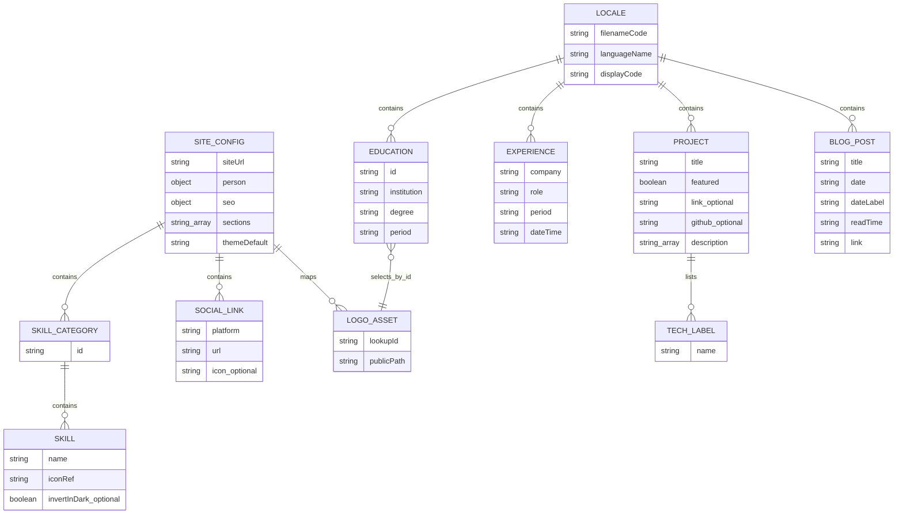

# Data model and lifecycle

Purpose: describe authored records and browser state. Intended reader: content editors and developers.

Last verified against commit `e7f95698811156a1fa4a1807fdd6cc2c6e5a5e76` on 2026-10-18.

## Storage model

**[Verified]** There is no database, ORM, migration framework, or application-server persistence. Identity/settings/skills live in site JSON, theme overrides in theme JSON, and section wording/record arrays in locale JSON. Static HTML and llms content remain separate. Config and locales are bundled into the browser; public media paths are served as files. Visitors cannot edit these records. Sources: [config](../src/config/index.ts), [site](../src/config/site.json), [theme](../src/config/theme.json), [i18n:6](../src/i18n/i18n.tsx#L6).

**[Verified]** [en.json](../src/locales/en.json) has top-level `language`, `nav`, `hero`, `about`, `experience`, `education`, `projects`, `skills`, `blog`, `contact`, `footer`, `common`, and `notFound` objects. Nested field names are the lookup API. There is no `src/config/content.json`; experience/education/project/article arrays still live in locales, including factual fields and per-record links.

| Logical record | Fields / constraints in current code | Consumer |
| --- | --- | --- |
| Language metadata | `name`, `code` display label; actual language ID comes from filename | [i18n](../src/i18n/i18n.tsx) |
| About paragraphs/stat | `paragraphs: string[]`; stats `{value, label}[]`; values remain strings | [About](../src/components/sections/About.tsx) |
| Experience item | `company`, `role`, `period`, `dateTime`, `description: string[]` | [Experience](../src/components/sections/Experience.tsx) |
| Education item | `id`, `institution`, `degree`, `period`, `details: string[]`; ID maps to local logo | [Education](../src/components/sections/Education.tsx) |
| Project item | `title`, optional `link`, `github`, `isExternal`; `description: string[]`, `tech: string[]`, `featured: boolean` | [Projects](../src/components/sections/Projects.tsx) |
| Blog post | `title`, `excerpt`, `date`, `dateLabel`, `readTime`, `link`; date label is authored separately | [Blog](../src/components/sections/Blog.tsx) |
| Contact | Site `person.email` and `contact.secondaryButton.{platform,url}`; locale button/heading text and summary | [Contact](../src/components/sections/Contact.tsx) |
| Skill category | Site `skills[{id,items:[{name,icon,invertInDark?}]}]`; locale category labels | [Skills](../src/components/sections/Skills.tsx), [config types](../src/config/index.ts) |
| Social link | Site `social[{platform,url,icon?}]`; locale labels, platform-to-icon/hover lookup in code | [Footer](../src/components/Footer.tsx), [BrandIcons](../src/components/icons/BrandIcons.tsx) |

**[Verified]** Additional site config groups are `siteUrl`; `person` (name, job title, email, location, profile image, resume URL); `seo` (title, descriptions, creation date, theme color); `theme.default`; `sections`; `blogUrl`; and `educationLogos`. Theme JSON contains `light` and `dark` dictionaries of CSS variable names to values. `$`-prefixed keys are comments excluded from theme injection. `siteConfig`/`themeConfig` use TypeScript assertions, not schema validation. Only four missing site fields are logged: site URL, name, email, and SEO title ([config:31](../src/config/index.ts#L31)).

**[Verified]** Interfaces are local TypeScript interfaces, not JSON validators. A cast through `tr<T>()` does not enforce field presence or element types. Some missing arrays default to empty, but a non-array value can still break `.map`/`.filter`. `isExternal` is currently unused by the project renderer. No uniqueness/index constraints are enforced; titles and company/role combinations serve as React keys.

## Conceptual entity relationships

Caption: these are JSON containment and lookup relationships, not SQL tables or foreign keys. How to read: locales own portfolio record arrays, config owns skill/social/logo records, and education IDs select configured public logo paths. Theme token dictionaries are described above, outside this diagram. Evidence: [locale](../src/locales/en.json), [site](../src/config/site.json), [Education:7](../src/components/sections/Education.tsx#L7).

## Runtime state and persistence

| State | Location / lifetime | Behavior |
| --- | --- | --- |
| Selected language | React context and localStorage `lang` | Restore only codes present in bundled translations; otherwise default English |
| Theme | next-themes provider plus injected token CSS | `siteConfig.theme.default` currently system; persistence delegated to dependency |
| Project visibility/open row | Projects component state | `false`/`0` initial values; reset on remount |
| Experience/education open row | Each section's state | Initially index zero; current click can set null |
| Menu, active section, scrolled header | Navbar state | Browser session/component lifetime only |
| Revealed sections | Scroll-hook state | First intersection sets visible and stops observing that element |
| Toasts | Module memory and timers | Not durable; hook limits visible store to one toast |

**[Verified]** Sources: [i18n:50](../src/i18n/i18n.tsx#L50), [App](../src/App.tsx), [Projects](../src/components/sections/Projects.tsx), [Navbar](../src/components/Navbar.tsx), [scroll hook](../src/hooks/useScrollAnimation.ts), [toast hook](../src/hooks/use-toast.ts). Theme storage key/synchronization is delegated rather than configured in local source. The checked-in app adds no language `storage` listener; cross-tab language synchronization is not implemented.

## Lifecycle and edits

**[Verified]** Authored config/content follows commit → dependency install → dev/build generator → static artifact → browser. The generator overwrites changed sitemap/robots/manifest outputs and uses the UTC build day for sitemap `lastmod`. No SQL migrations, retention jobs, uploads, or record-deletion endpoints exist. Public media is copied into the artifact; config-only replacement needs no source import but still needs deployment. Browser language preferences remain until cleared/overwritten; unsupported codes are ignored. Storage denial has no exception handler. Sources: [generator](../scripts/site-files.ts), [i18n](../src/i18n/i18n.tsx).

**[Recommendation]** Change facts/settings in config and revise locale prose/arrays, locale `geoSummary`, static HTML/JSON-LD, and `llms.txt` where duplicated. Run dev/build for generated outputs; do not hand-edit them. Reset a stale language preference from the browser console with `localStorage.removeItem('lang')`, then reload. This affects only that origin's language key, not source content.

Next: [API and integrations](07-api-and-integrations.md).
