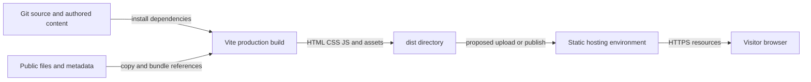

# Operations and release reference

Purpose: explain build artifacts, release checks, and operational limits. Intended reader: maintainers and operators.

Last verified against commit `0d6ea67e368badc5e2d52b7c601ea167c6be6208` on 2026-10-17.

## Build and environment behavior

**[Verified]** [package.json](../package.json) defines `build` as `vite build`, `build:dev` as `vite build --mode development`, and `preview` as `vite preview`. [Vite](../vite.config.ts) enables the Lovable component tagger only in development mode. The normal production build does not enable that plugin. Typechecking is separate; Vite compilation alone is not a full TypeScript check.

**[Verified]** The repository contains no custom Vite output directory, base path, or asset cache configuration. Build output defaults to `dist/`, which is ignored. Static `public/` files are part of the site artifact. Runtime environment-variable selection is not implemented; the canonical origin is hardcoded in several files ([HTML](../index.html), [Index](../src/pages/Index.tsx), [NotFound](../src/pages/NotFound.tsx), [robots](../public/robots.txt), [sitemap](../public/sitemap.xml)).

**[Verified]** The checked-in npm lockfile is out of sync with the manifest: `npm ci --no-audit --no-fund` failed with `EUSAGE` during this review, including missing Testing Library, jsdom, Vitest, and react-helmet-async entries. Reproducible clean installation is currently blocked. A local verification workaround is `npm install --no-package-lock`; it resolves manifest ranges and therefore is not an equivalent reproducible install. Dependency repair is proposed work, outside this docs-only change.

## Release artifact path

Caption: the build produces a static release artifact. How to read: upload/publish and host boxes describe the required release boundary; the actual infrastructure and automation are **[Unknown]**, not checked-in deployment resources.

**[Verified]** No CI workflow directory, Dockerfile, infrastructure definition, deployment script, environment promotion policy, monitoring config, or server config was found among tracked files. The [original README](../README.md) describes Lovable publishing but retains a placeholder project ID. **[Unverified, from original doc]** Its claims about Git push synchronization and Share → Publish are preserved there; an actual linked Lovable account/project and current publishing UI were not verified.

## Suggested release procedure

This is a proposed runbook derived from the source, not evidence of an existing automated pipeline:

1. Resolve package-manager/lockfile ownership. Until fixed, follow the documented local workaround in [setup](02-getting-started.md) and record resolved dependency differences.
2. Run `npm test`, `npm run lint`, both documented TypeScript checks, and `npm run build`. Compare existing failures with the [baseline](CHANGELOG.md); do not present a failing check as passing.
3. Run `npm run preview`; complete the [manual smoke checks](02-getting-started.md). Include failed lazy chunk requests, keyboard interactions, mobile menu, and outbound destinations.
4. Confirm all public-origin references and content/SEO copies are correct for the intended domain.
5. Publish the built artifact through the actual hosting workflow once identified. Configure app-path fallback to `index.html`, while serving static asset paths correctly. Decide whether unmatched routes should return real HTTP 404 or the app shell; React alone does not set HTTP status.
6. Check root page, a deep unmatched URL, icons, `robots.txt`, `sitemap.xml`, and metadata after release. Preserve a known-good artifact/version and record rollback instructions for the chosen platform.

**[Unknown]** DNS/TLS ownership, production headers, CDN rules, retention of old hashed chunks, rollback controls, release permissions, and uptime/error budgets need an operator's answer. New JavaScript can reference old/new hashed chunks during a deployment; stale-cache or removed-chunk failure behavior has no application-level recovery UI ([Index](../src/pages/Index.tsx), [App](../src/App.tsx)).

## Logging and diagnosis

**[Verified]** The only application logging found is NotFound's `console.error` with the attempted path ([NotFound:8](../src/pages/NotFound.tsx#L8)). No server logs, centralized logger, client error reporter, analytics events, or performance monitoring are configured in the inspected source. Vite's HMR overlay is off.

Recommended incident triage:

| Symptom | First evidence to inspect | Likely boundary |
| --- | --- | --- |
| Blank page after static HTML disappears | Browser console; entry/chunk network requests | React mount or chunk loading |
| Lower sections invisible | Lazy imports, observer callbacks, opacity classes | Suspense/reveal logic |
| Wrong copy or project count | Compare JSON, JSON-LD, HTML, llms.txt | Authored content drift |
| Missing icons/fonts | Resource requests and content blockers | External resources |
| Direct deep URL returns host error | Response status and fallback rules | Hosting/router boundary |
| Language reset/crash | Origin storage access and available locale codes | i18n persistence |

## Security and public data

**[Verified]** Public content includes biography, employment, education, contact details, and profile links. Site metadata and crawler files intentionally expose those authored details. No account system, private data store, or contact-submission service is implemented. `robots.txt` is an allow policy, not access control. Manifest/icons do not create offline support; no service worker was found.

**[Recommendation]** Keep credentials out of locale JSON, `public/`, and client-visible environment variables. Validate any future user-authored URLs/content before extending the current trusted-source model. Establish CSP/security headers at the chosen host, allowing only the resources actually needed, and assess compatibility with existing inline JSON-LD and font-loading code before rollout. Dependency vulnerabilities and production headers were not audited in this documentation task.

Next: [Risks and recommendations](09-risks-and-recommendations.md).
