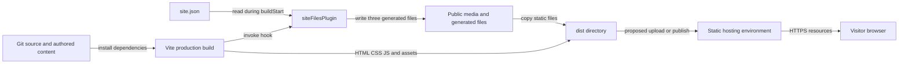

# Operations and release reference

Purpose: explain build artifacts, release checks, and operational limits. Intended reader: maintainers and operators.

Last verified against commit `e7f95698811156a1fa4a1807fdd6cc2c6e5a5e76` on 2026-10-18.

## Build and environment behavior

**[Verified]** [package.json](../package.json) defines `build` as `vite build`, `build:dev` as `vite build --mode development`, and `preview` as `vite preview`. [Vite](../vite.config.ts) enables the Lovable component tagger only in development mode. The normal production build does not enable that plugin. Typechecking is separate; Vite compilation alone is not a full TypeScript check.

**[Verified]** There is no custom Vite output directory, base path, or asset-cache policy. Output defaults to ignored `dist/`; public media and generated files are included. Runtime environment-variable selection is not implemented. Site config supplies runtime canonical URLs and generator inputs; static `index.html` metadata/JSON-LD and `llms.txt` still contain authored origin/person data. Sources: [site config](../src/config/site.json), [Index](../src/pages/Index.tsx), [NotFound](../src/pages/NotFound.tsx), [generator](../scripts/site-files.ts), [HTML](../index.html).

**[Verified]** The npm lockfile remains out of sync: direct dependency entries for Testing Library, jsdom, Vitest, and react-helmet-async are missing. The earlier `npm ci` failure and local `npm install --no-package-lock` workaround are recorded in [verification history](CHANGELOG.md). Manifest/lockfiles are unchanged by the template merge. The workaround resolves ranges and is not a reproducible locked install; dependency repair remains separate work.

**[Verified]** [siteFilesPlugin](../scripts/site-files.ts) runs in Vite's `buildStart` hook for dev and both build modes. It reads config from the repo working directory and rewrites changed `public/sitemap.xml`, `public/robots.txt`, and `public/site.webmanifest`. Sitemap `lastmod` is the current UTC day. Robots allows its fixed crawler list and points to the configured origin; manifest names/colors come from config, while icon paths remain fixed. Preview serves the previous artifact rather than generating a new one. No custom watch handler guarantees regeneration after a config edit, so restart/rebuild. **Do not hand-edit these three outputs** ([AGENTS.md](../AGENTS.md)). HTML and llms content are outside this generator.

## Release artifact path

Caption: the build produces a static release artifact. How to read: upload/publish and host boxes describe the required release boundary; the actual infrastructure and automation are **[Unknown]**, not checked-in deployment resources.

**[Verified]** No CI workflow directory, Dockerfile, infrastructure definition, deployment script, environment promotion policy, monitoring config, or server config was found among tracked files. The [original README](../README.md) describes Lovable publishing but retains a placeholder project ID. **[Unverified, from original doc]** Its claims about Git push synchronization and Share → Publish are preserved there; an actual linked Lovable account/project and current publishing UI were not verified.

## Suggested release procedure

This is a proposed runbook derived from the source, not evidence of an existing automated pipeline:

1. Resolve package-manager/lockfile ownership. Until fixed, follow the documented local workaround in [setup](02-getting-started.md) and record resolved dependency differences.
2. Run `npm test`, `npm run lint`, both documented TypeScript checks, and `npm run build`. Compare existing failures with the [baseline](CHANGELOG.md); do not present a failing check as passing.
3. Run `npm run preview`; complete the [manual smoke checks](02-getting-started.md). Include failed lazy chunk requests, keyboard interactions, mobile menu, and outbound destinations.
4. Review site/theme config, all locale prose/records, static HTML/JSON-LD, and `llms.txt` for the intended identity/domain. Inspect generator diffs after the build; do not manually repair generated output. Confirm configured section targets and public media files exist.
5. Publish the built artifact through the actual hosting workflow once identified. Configure app-path fallback to `index.html`, while serving static asset paths correctly. Decide whether unmatched routes should return real HTTP 404 or the app shell; React alone does not set HTTP status.
6. Check root page, a deep unmatched URL, icons, `robots.txt`, `sitemap.xml`, and metadata after release. Preserve a known-good artifact/version and record rollback instructions for the chosen platform.

**[Unknown]** DNS/TLS ownership, production headers, CDN rules, retention of old hashed chunks, rollback controls, release permissions, and uptime/error budgets need an operator's answer. New JavaScript can reference old/new hashed chunks during a deployment; stale-cache or removed-chunk failure behavior has no application-level recovery UI ([Index](../src/pages/Index.tsx), [App](../src/App.tsx)).

## Logging and diagnosis

**[Verified]** NotFound logs attempted paths ([NotFound:11](../src/pages/NotFound.tsx#L11)); config initialization logs four missing required fields ([config:31](../src/config/index.ts#L31)). Those checks do not throw or validate complete shapes. No centralized logger, client error reporter, analytics, or performance monitoring is configured. Generator JSON/filesystem errors propagate to the Vite process. HMR's error overlay is off.

Recommended incident triage:

| Symptom | First evidence to inspect | Likely boundary |
| --- | --- | --- |
| Blank page after static HTML disappears | Browser console; entry/chunk network requests | React mount or chunk loading |
| Lower sections invisible | Lazy imports, observer callbacks, opacity classes | Suspense/reveal logic |
| Wrong copy or project count | Compare JSON, JSON-LD, HTML, llms.txt | Authored content drift |
| Missing icons/fonts | Resource requests and content blockers | External resources |
| Direct deep URL returns host error | Response status and fallback rules | Hosting/router boundary |
| Language reset/crash | Origin storage access and available locale codes | i18n persistence |
| Config edit does not reach sitemap/manifest | Confirm generator ran in repo CWD; restart dev/rebuild | Build-time generation rather than preview/runtime |
| Wrong logo/social icon or missing section | Config IDs/paths, brand map, known sectionMap keys | Config-to-component contracts |

## Security and public data

**[Verified]** Public content includes biography, employment, education, contact details, and profile links. Site metadata and crawler files intentionally expose those authored details. No account system, private data store, or contact-submission service is implemented. `robots.txt` is an allow policy, not access control. Manifest/icons do not create offline support; no service worker was found.

**[Recommendation]** Keep credentials out of site/theme config, locales, public files, and client-visible environment variables. Validate future untrusted URLs/content/CSS before extending the current authored-source model. Establish CSP/security headers at the chosen host and check compatibility with inline JSON-LD, font-loading code, next-themes, and the injected `style#theme-config` element. Dependency vulnerabilities and production headers were not audited in this task.

Next: [Risks and recommendations](09-risks-and-recommendations.md).
