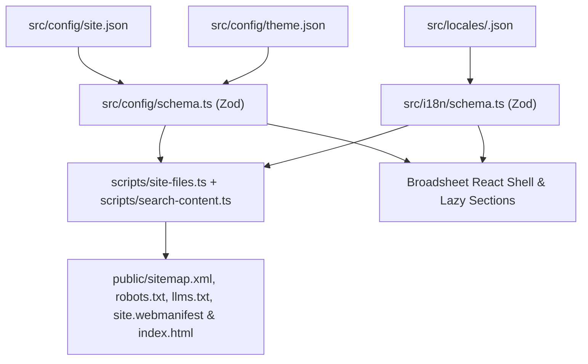

# Broadsheet Redesign Specification & Implementation Map

Purpose: map the finalized HTML prototype ([docs/prototype/broadsheet-prototype.html](prototype/broadsheet-prototype.html)) and design system ([DESIGN.md](../DESIGN.md), [SKILL.md](../SKILL.md)) to the repository's configurable React architecture. Intended reader: developers, reviewers, and agents executing the redesign.

---

## 1. Architectural Alignment Overview

The Broadsheet Newspaper redesign replaces the visual presentation layer while strictly preserving the repository's **configuration-first architecture** ([AGENTS.md](../AGENTS.md)):



---

## 2. File-by-File Implementation Map

| Target File | Planned Changes (No Hardcoded Content) | Config / Locale Source |
| :--- | :--- | :--- |
| [index.html](../index.html) | Replace `Archivo` font links with non-render-blocking Google Fonts for `Fraunces`, `Newsreader`, and `IBM Plex Mono`. Keep `<!-- generated:metadata -->` and `<!-- generated:content -->` markers intact. | Build-time injection via [scripts/site-files.ts](../scripts/site-files.ts) |
| [tailwind.config.ts](../tailwind.config.ts) | Map `fontFamily.display` → `['Fraunces', 'Georgia', 'serif']`, `fontFamily.sans` / `fontFamily.serif` → `['Newsreader', 'Georgia', 'serif']`, and `fontFamily.mono` → `['IBM Plex Mono', 'monospace']`. | CSS variables from `src/index.css` & `src/config/theme.json` |
| [src/index.css](../src/index.css) | Set Day Newsprint (`:root`) and Night Press (`.dark`) HSL variables; replace `.hero-hex`, `.gradient-*`, and `.blob-*` utilities with `.broadsheet-page`, `.r-t`, `.r-b`, `.r-l`, `.r-r`, `.r-box`, `.r-heavy-t`, `.r-heavy-b`, `.r-double-t`, `.r-double-b`, `.lead-dropcap`, `.engraving-photo`, `.scissor-coupon`, and `.dossier-flash`. | Overridable via `src/config/theme.json` |
| [src/config/site.json](../src/config/site.json) & [src/config/schema.ts](../src/config/schema.ts) | Add `continuingEducationUrl` (`https://www.linkedin.com/in/ru5iru/details/certifications/`) validated by `webUrl`; update `seo.themeColor` to `#efe8d8`. | `siteConfig` |
| [src/config/theme.json](../src/config/theme.json) | Configure `light` (Day Newsprint) and `dark` (Night Press) HSL token overrides (`background`, `foreground`, `card`, `primary`, `secondary`, `muted`, `accent`, `border`, `ring`). | Injected at startup by `applyTheme()` |
| [src/locales/en.json](../src/locales/en.json) & [src/i18n/schema.ts](../src/i18n/schema.ts) | Strip leading emojis from `about.paragraphs`; add broadsheet section kickers/labels, `education.certifications` array (5 items), and `skills` adaptability philosophy + per-domain notes. | Auto-discovered by `src/i18n/i18n.tsx` |
| [scripts/search-content.ts](../scripts/search-content.ts) | Include `education.certifications` in the static HTML fallback and `public/llms.txt` under Education & Continuing Education; remove stat-box list output from the `about` static fallback if `about.stats` is omitted/empty. | Shared build/dev generator |
| [src/pages/Index.tsx](../src/pages/Index.tsx) | Frame the application inside the outer desk background and `.broadsheet-page` sheet container while preserving `<LoadBoundary>` and `<Suspense>` per section. | `siteConfig.sections` |
| [src/components/Navbar.tsx](../src/components/Navbar.tsx) | Render the Top Desk Utility Bar (`Unfold All Dispatches & Logs`, `ThemeToggle`, `LanguageSelector`), the centered Broadsheet Masthead (`siteConfig.person.name`), and the Section Index Bar (desktop horizontal strip + mobile Radix `Dialog`). | `siteConfig.sections` & `nav.*` locale keys |
| [src/components/sections/Hero.tsx](../src/components/sections/Hero.tsx) & [src/components/sections/About.tsx](../src/components/sections/About.tsx) | Render Section A1 (Front-Page 12-Column Newspaper Puzzle): Banner headline + 3-column grid (Left: Career Progression brief with jump links; Center: `.engraving-photo` portrait plate + CTAs + 2-column `.lead-dropcap` `about.paragraphs`; Right: Featured Dispatches & CE brief cards). No stat counter boxes or availability ear. | `siteConfig.person`, `hero.*`, `about.*`, `experience.items`, `projects.items` |
| [src/components/DisclosureRow.tsx](../src/components/DisclosureRow.tsx) | Style the shared `@radix-ui/react-collapsible` row as a Broadsheet Dispatch/Dossier card with collapsed 1-line lead preview, numbered bullets (`§` / `[01]`), and separate outbound link controls. | Shared primitive |
| [src/components/sections/Experience.tsx](../src/components/sections/Experience.tsx) | Render Section A2 (`Work Experience`) with all verbatim `experience.items` bullets, individual row folding, and an `Unfold All Roles` toggle button. | `experience.*` |
| [src/components/sections/Education.tsx](../src/components/sections/Education.tsx) | Render Section B1 (`Education & Continuing Education`): 12-column split with `education.items` + `siteConfig.educationLogos` on the left (5 cols) and `education.certifications` + LinkedIn ledger link on the right (7 cols). | `education.*`, `siteConfig.educationLogos`, `siteConfig.continuingEducationUrl` |
| [src/components/sections/Projects.tsx](../src/components/sections/Projects.tsx) | Render Section B2 (`Featured Projects`) with `Featured` / `All Works` filter tabs, `Unfold All Project Logs` toggle, verbatim `projects.items` descriptions, and the bottom `View More Projects` / `Show Less` button. | `projects.*` |
| [src/components/sections/Skills.tsx](../src/components/sections/Skills.tsx) | Render Section C1 (`Core Domains & Representative Stack`): 12-column layout with adaptability philosophy on the left (4 cols) and understated horizontal domain rows on the right (8 cols). | `siteConfig.skills` & `skills.*` |
| [src/components/sections/Blog.tsx](../src/components/sections/Blog.tsx) | Render Section C2 (`Latest Blog Posts`) as a 3-column print article grid with `Visit My Blog ↗`. | `blog.*` & `siteConfig.blogUrl` |
| [src/components/sections/Contact.tsx](../src/components/sections/Contact.tsx) & [src/components/Footer.tsx](../src/components/Footer.tsx) | Render Section C3 (`Correspondence & Dispatch`): Left 5 cols for Direct Channels & `siteConfig.social` directory; Right 7 cols for `.scissor-coupon` (`mailto:` + secondary button); plus double-ruled Colophon footer. | `contact.*`, `footer.*`, `siteConfig.person.email`, `siteConfig.social` |

---

## 3. Data Model Additions (`src/locales/en.json` & `src/config/site.json`)

### 3.1 Continuing Education Record Shape (`education.certifications`)

```json
{
  "issuer": "KONG",
  "date": "Issued Oct 2026",
  "title": "Microservices Foundations Professional Certificate by Kong",
  "skills": "Software Design Patterns · Software Architecture",
  "url": "https://www.linkedin.com/in/ru5iru/details/certifications/"
}
```

Curated default records (from LinkedIn Licenses & Certifications):
1. **Microservices Foundations Professional Certificate by Kong** (*KONG* · Issued Oct 2026 · Skills: `Software Design Patterns · Software Architecture`)
2. **NIST Cybersecurity Framework (CSF) 2.0 Primer: From Fundamentals to Implementation** (*PEARSON / LINKEDIN* · Issued Oct 2026 · Skills: `IT Security Best Practices`)
3. **Working with the PCI DSS 4.0 Compliance Requirements** (*LINKEDIN* · Issued Oct 2026 · Skills: `Payment Card Industry Data Security Standard (PCI DSS) · Standards Compliance`)
4. **GDPR Compliance: Essential Training** (*LINKEDIN* · Issued Nov 2026 · Skills: `Legal Compliance · General Data Protection Regulation (GDPR)`)
5. **Negotiation Professional Certificate by American Negotiation Institute** (*AMERICAN NEGOTIATION INSTITUTE* · Issued Nov 2026 · Skills: `Strategic Negotiations · Interpersonal Skills`)

### 3.2 Cross-Section Jump & Global Unfold Event Contract

To allow the Front Page brief cards (`Read full dispatch in Sec A2 →` / `Unfold full dossier in Sec B2 →`) and the Top Desk Utility Bar (`⊞ Unfold All Dispatches & Logs`) to coordinate with lazy-loaded sections without tight coupling:
- Dispatch a typed custom DOM event on `window` (e.g., `broadsheet:jump` with `{ section: 'experience' | 'projects', index: number }` and `broadsheet:toggle-all` with `{ expanded: boolean }`) alongside `navigateToSection(sectionId)` in [src/lib/navigation.ts](../src/lib/navigation.ts).
- `Experience.tsx` and `Projects.tsx` listen for these events, update their open index set (`Set<number>`), scroll the target `#exp-card-${index}` or `#proj-card-${index}` into view once mounted, and apply the `.dossier-flash` class.
